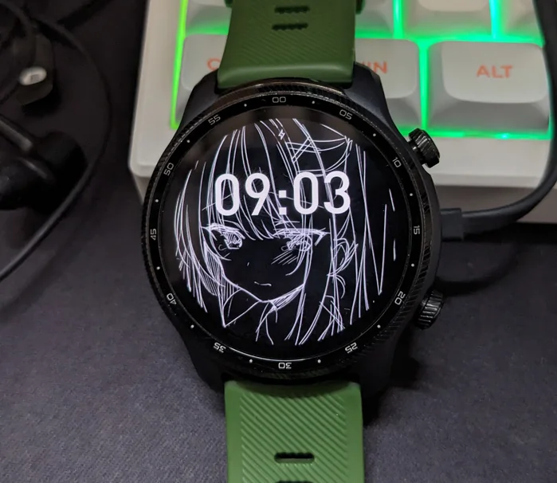
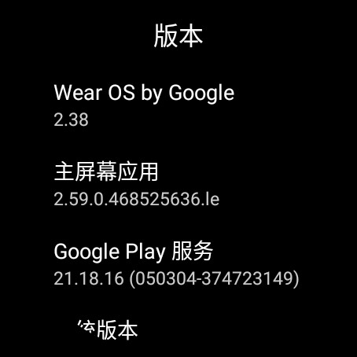
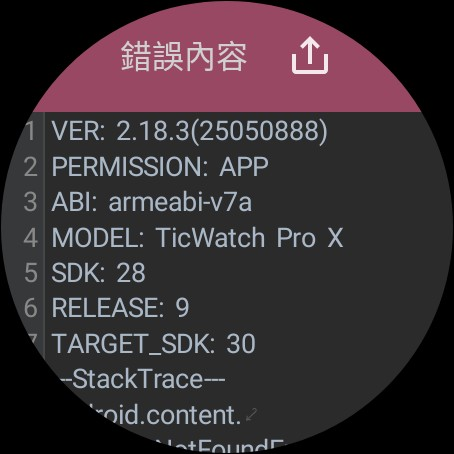
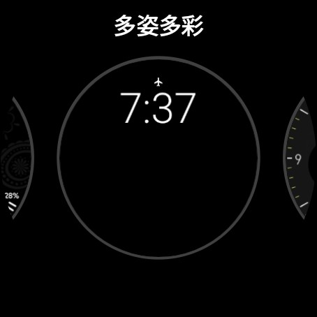

# TicWatch Pro X 折腾留档

## 前言

实际上原本是写使用体验记录的 但是我不会写 也不想写（）

退而求其次 这块表也是2021年的产物了，我买的时候还是在海鲜市场捡的二手（2025年3月）

> 头图镇压

## 折腾与留档

表已经出掉了，留个档，顺便记录下当时遇到的问题

国行系统无法安装64位应用

国行系统没办法添加国外eSIM，国内eSIM又停止办理了

持久模式切换时有概率让检测记录消失，并且续航没有宣称的那么好

系统bug也多

  
  
  

WearOS工具箱,出门问问,WearOS by Google 国行版等安装包，已留档到我的永硕E盘

欢迎来我的网盘下载或者上传文件

[点我前往-testuser的避难所](https://testuser.ysepan.com/)

## 碎碎念

它确实不是一块出色的智能表，但是可玩性确实独一无二，能刷国际版WearOS3还能root 

也陪我度过了高中好几个月的晚自习

成也因WearOS，败也因WearOS（2026/1/7 mobvoi(出门问问)发布新表 ticnote watch 但是系统不是WearOS了）

